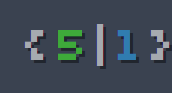
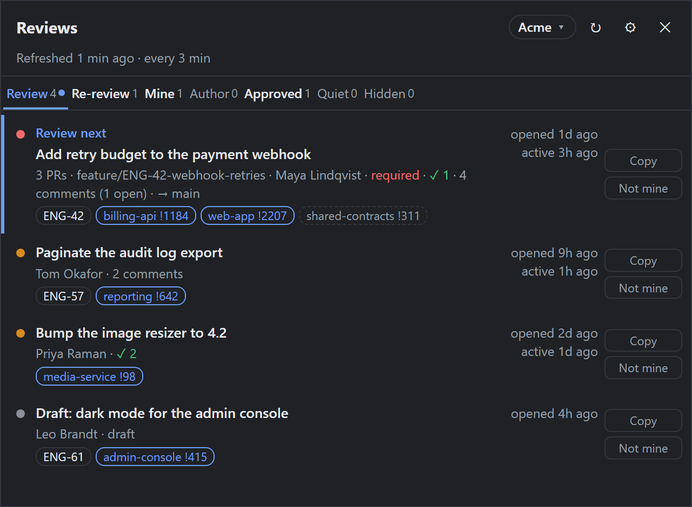
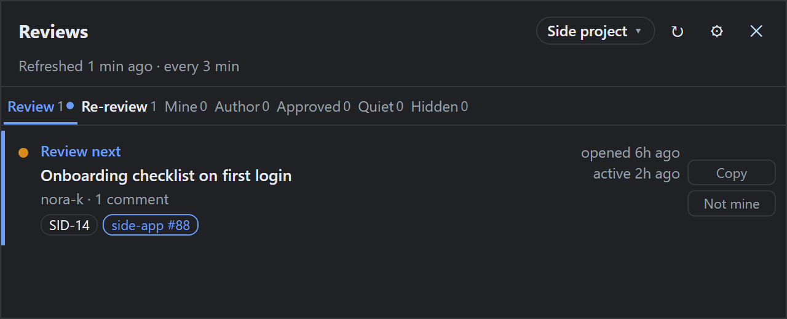
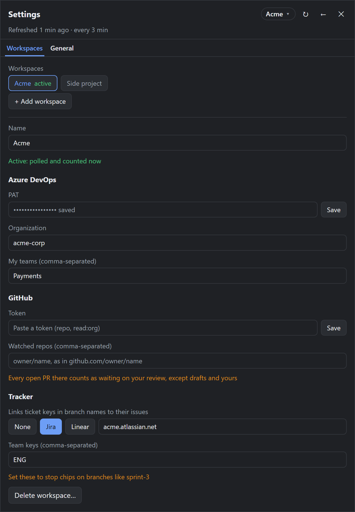
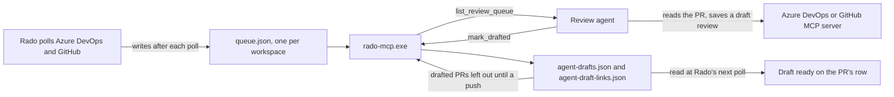

<p align="center"></p>

# Rado

Rado is a Windows tray app that shows the pull requests waiting for your review, across Azure DevOps and GitHub. A small counter on your desktop shows how many reviews you have and how many of your own PRs need work. Click it for a ranked list. Workspaces keep separate setups apart, for example your company's Azure DevOps and Jira and a side project's GitHub and Linear.

## Quick setup

1. **Install.** Download `Rado_<version>_x64-setup.exe` from the [latest release](https://github.com/antonjoyglow/rado/releases/latest) and run it. It installs for your user only. The installer isn't code-signed, so Windows SmartScreen may warn you; choose **More info → Run anyway**.
2. **Create a token** for each source you use:
   - **Azure DevOps PAT:** **Code (Read)** is the only scope it needs.
   - **GitHub token:** a classic token with `repo` (to read private repos) and `read:org` (to see review requests to your teams). A fine-grained token with *Pull requests: Read* and *Metadata: Read* may work instead for a single org (some orgs must approve it first).
3. **Fill in your workspace.** The counter shows `!` beside Rado's bird until a token is saved. Click it (or the tray icon), and the list opens on **Settings → Workspaces**, where a workspace named *Default* is ready. Give it a name, then:
   - Azure DevOps: paste the PAT, then fill in **Organization** (`yourorg`, as in `dev.azure.com/yourorg`; pasting a `dev.azure.com` or `yourorg.visualstudio.com` link works too) and, if your teams get review requests, **My teams** (comma-separated).
   - GitHub: paste the token. Optionally, add **Watched repos** (`owner/name`) to count every open PR in them as a review.

   Every field saves when you leave it, tokens also on Enter. Tokens go to Windows Credential Manager; **Remove…** beside a saved one deletes it and turns that source off.
4. **Optional: link tickets.** Under **Tracker**, pick **Jira** and enter your site (`yourcompany.atlassian.net`), or **Linear** and enter your workspace (`yourteam`, as in `linear.app/yourteam`). Set **Team keys** (`ENG, OPS`) so only those keys become ticket chips.
5. **Optional: more workspaces.** **+ Add workspace** adds another; switch with the chip in the list's header or **Ctrl+←** / **Ctrl+→**. Only the active workspace is polled and notifies.
6. **Optional: the MCP server** for Claude review agents (Azure DevOps and GitHub PRs):

   ```
   claude mcp add --scope user rado -- "%LOCALAPPDATA%\Rado\rado-mcp.exe"
   ```

   That is for cmd; in PowerShell, write the path as `"$env:LOCALAPPDATA\Rado\rado-mcp.exe"`.

Not verified yet: the SmartScreen prompt on a fresh download, and a fine-grained GitHub token.

## Walkthrough



**The counter.** Left of the bird: reviews waiting on you. Right: your own PRs that need work. Click it to open the list; drag it anywhere.



**The list.** One tab per section; the top-ranked review is marked *Review next*. A row whose branch names a ticket gets a ticket chip (`ENG-42`), and each PR gets its own chip; a dashed chip is a PR on the same branch that you aren't asked to review (Azure DevOps only). Click a row to open every PR in it, or a chip to open one.


**Switching workspaces.** Click the workspace chip, or press **Ctrl+←** / **Ctrl+→** in the list.



**Another workspace.** Its own list, here a GitHub PR (`#88`) linked to a Linear ticket.



**Settings → Workspaces** (⚙ in the header). Sources, watched repos, tracker and team keys for each workspace.


**Settings → General.** Check every (polling interval), text size, list width and height, theme (shown: *Light*), browser, notifications and start with Windows.


**Settings → Counter.** A live preview, a colour for each number (heat by default) and for the logo, opacity at rest and near the cursor, and size. **Reset to default** brings back the default look.


**The tray icon.** Left-click opens the list. Right-click for **Show reviews**, **Refresh now** and **Quit**.

## Reference

### Counter

- `reviews`, Rado's bird, `mine`; the bird is white by default. *Reviews* are the review rows waiting on you; *mine* are the rows of your own PRs with a rejection, a waiting-for-author vote or an open thread, not all your open PRs.
- By default each number is coloured by count (*Heat*): blue at 0, then cyan, green, yellow and orange, up to red at 10 or more.
- `!` and the bird, with no mine number: the active workspace has no token, or a source is failing and the list is older than two refreshes (or that source never loaded). The tooltip starts with the active workspace's name and ends with when the list was last checked. The list's age is the oldest of its sources, so one failing source isn't hidden by another's fresh answer.
- Always on top. By default it sits at 55% opacity and fades to 8% when the cursor comes within 15% of its bounds. It starts at the bottom right of the primary screen, 12 px from the edges, and reopens where you left it, moved back on screen if it would stick out.
- **Settings → Counter** changes its look; each change saves as you pick it.
  - *Reviews number* and *Mine number*: **Heat**, a swatch, the colour picker or a typed hex colour. *Logo* (the bird and the `!`): the same without Heat. Settings saved by 0.9.0 keep their braces colour as the logo colour.
  - *Opacity at rest*: 20–100% (chips for 30, 55, 80 and 100%). *Opacity near the cursor*: 0–100% (chips for 0, 8, 25 and 50%).
  - *Size*: 75% to 200%; − / + step by 25%, or type a whole percent. It grows around its right edge.
  - **Reset to default**: heat numbers, white logo, 55% / 8% opacity, 100% size.

### List

- It opens against the screen edge on the counter's side (left or right), level with the counter and kept on screen, on the counter's screen. The counter is hidden while the list is open and comes back when it closes: ✕, **Esc**, or a click anywhere else.
- *List width* (20–100% of the screen, chips for 25%, 33%, Half and Full; never under 360 px) and *List height* (25–100%, chips for Half and Full) are in **Settings → General**. The default is 33% wide and half the screen high. Pixel sizes saved by 0.9.0 are dropped for these defaults.
- **New version:** Rado asks GitHub for its latest release at start and every 6 hours. When it is newer, the status line under the title reads *Rado x.y.z is available · Download*, and **Download** opens the release's installer in your default browser. Run it to update; Rado itself downloads and installs nothing. Offline or rate-limited checks stay silent.
- Tabs: *Review* (needs your review), *Re-review* (new pushes since your vote), *Mine* (your PRs), *Author* (waiting on author), *Approved* (by you or your team), *Quiet* (no activity for 3 weeks) and *Hidden* (Not mine or hidden). All seven always show, each with its count; empty ones are muted. Arrow keys, Home and End move between tabs.
- When every source has answered and every listed PR is your own, the empty *Review* tab says Rado lists PRs where you or your teams are reviewers, and, with a GitHub token, links to **Watched repos**.
- The list reopens on the tab you last chose. Before you choose one, it opens the first of *Review*, *Re-review* and *Mine* that had rows at start. Each tab keeps its scroll position.
- *Mine* is grouped by branch, newest first. You get a notification when one of your PRs starts needing you.
- **Review next:** the top-ranked review's details start with *Review next*, its row gets a tint and an accent bar, and its tab gets a dot. Rows you opened since Rado started move behind the others; once you've opened them all, it marks the one you opened longest ago.
- **Rows:** PRs with the same source branch in different repos form one row (*N PRs · branch*), titled and placed by their highest-ranked PR, with summed approvals and comments. GitHub and Azure DevOps PRs never share a row. PR chips read `repo !n` (Azure DevOps) or `repo #n` (GitHub).
- **Row details:** `✓ n` approved, `✗ n` rejected or waiting for author, `n comments (m open)` (system threads such as votes and pushes don't count), *required*, *draft*, and `→ <target>` when it merges into `master`, `main`, `qa` or `release`. On the right: *opened* and *active* (the latest push, vote, comment, reviewer or status change; activity in the first five minutes counts as opening). An aggregate uses its earliest PR's opening and its latest activity. Hover the details for each PR's exact times.
- **Draft ready** follows a PR's chip when a review agent has marked it drafted at its current commit through the [MCP server](#mcp-server). If the agent recorded a link, it is a button that opens the draft in your browser, and its hover text names the site; otherwise it is plain text. Rado reads the marks at each poll, so a new one shows after the next refresh, and a push since the draft removes it.
- **Copy** and **Not mine** (or **Hide**, **Show**) take the times' place while you hover a row or move into it with the keyboard; on a touchscreen they stay beside the times.
- **Copy** copies the PR link; for an aggregate, one `repo: link` line per PR.
- **Not mine** (on a review) or **Hide** (on your own PR) drops the row from the count and notifications until it closes. On GitHub that's until it leaves Rado's GitHub results, for example once a teammate covers a team request. A hidden PR is forgotten once its own source answers in full without it; while that source fails, answers in part or has no token, it stays hidden. One hidden before 0.10.0 has no recorded source until it's listed again, and until then waits for every source with a token to answer in full. A token that Windows Credential Manager can't read shows as an error for that source, not as a missing token. **Show** on the *Hidden* tab brings one back. Hiding is local; Azure DevOps or GitHub still lists you as a reviewer.
- **Quiet:** a review with no activity for 21 days leaves the count, notifications and the MCP queue, and moves to *Quiet*. Any activity brings it back, with a notification. Your own PRs never go quiet; a PR whose threads failed to load stays where it was.
- **Esc** closes the workspace picker, then leaves settings, then hides the list.

### Ranking

One score per PR. Needs review: 50; re-review: 45. Required: +25. Target `master`, `main`, `qa` or `release`: +15. Age: +1 per 4 hours, up to 30. Team-only assignment: −10. Draft: −40. 85 or more is urgent (red dot), 40 or more normal (orange); the rest are grey.

### Workspaces

- A workspace is a named set of sources (an Azure DevOps organization with its PAT and teams, a GitHub token, or both) and a tracker.
- The order doesn't wrap: Ctrl+→ on the last workspace does nothing. The keys don't switch while you type in a field.
- A switch drops any poll still running for the old workspace and refreshes the new one at once. Each workspace keeps its own list, votes, hidden PRs and notification baseline, so switching back shows its last list and only reviews that are new since its last poll notify. A workspace's first poll since Rado started records its reviews without notifying.
- Changing a workspace's Azure DevOps organization (ignoring case) forgets your votes and its Azure DevOps hidden PRs once the new organization answers, since PR ids repeat across organizations. Correcting a mistyped name before then keeps them, since a name that doesn't exist never answers.
- Deleting a workspace (after a confirm) removes its tokens and data. The last workspace can't be deleted.
- Upgrading from before 0.8.0 turns your settings into one workspace named after your organization (or *GitHub* with only a GitHub token, else *Default*). The old file is kept as `settings.pre-workspaces.json`, and the PAT and token move to the workspace's own keyring entries; the old entries are deleted once the new ones read back.

### Trackers

- A ticket key in a branch name (`ABC-12`, as in `feature/ABC-12-login`) becomes a chip that opens the issue in the workspace's Jira site or Linear workspace. Rado only builds the link; no tracker token is needed. With no tracker set, there are no chips. Pasting a Jira or Linear link into the field works too.
- Without team keys, upper-case keys count anywhere in the branch. With Linear, lower-case keys also count in Linear's branch shape (`anton/eng-123-add-login`). `release-2026`, `renovate/node-20`, `UTF-8`, `ISO-8601`, `SHA-256` and `CVE-2024-…` never make chips, but with Linear `chore/node-18-upgrade` and `claude/sprint-3-onboarding` do (NODE-18, SPRINT-3).
- With **team keys** set, only those keys count, in any case, at the start of the branch or after `/`, `-` or `_`. `hoo-312-ranks` gives HOO-312 and `claude/hoo-342-343-panels` gives HOO-342; `sprint-3` gives nothing.

### Sources

- Azure DevOps and GitHub (github.com) are polled at the same time. A source is on once its token is saved. If one fails, its PRs from the last good poll stay listed and the status line names it.
- A failing source waits before its next try: 3, 6, 12, 24, 48, then 60 minutes at the default 3-minute interval (up to an hour, or one interval if that is longer). From the second failure the status line adds *· next try 14:12*.
- When a source rate-limits Rado and names a time, Rado waits until then, or one interval if that is longer; the status line reads *GitHub: rate limited until 14:05*. **Refresh** retries a waiting source at once, except a rate-limited one. A good poll, a token save or removal, or a change to the source's settings ends the wait.
- A source's first good poll (new token, or after failing since start) records its reviews without notifying. A poll that was running when you switched workspaces, saved a token or changed the organization or teams is discarded.
- **Azure DevOps:** every active PR in the organization comes from one paged call. Rado keeps those where you, or one of **My teams**, is a reviewer. Teams match by name (`TeamAlpha` matches `[contoso]\TeamAlpha`). On a team-only PR, the team's vote decides the section. Your own open PRs go under *Mine*; PRs you declined are skipped. One extra call per listed PR fetches its threads and last activity; if it fails, the row shows no comments or activity.
- **GitHub:** one GraphQL call per poll searches every repo the token can see: reviews requested from you or your teams, open PRs you reviewed, and your own open PRs.
  - A push after your approval or change request moves it to *Re-review*. Your vote is your last approval or change request; a later comment doesn't replace it, and a dismissed vote counts as changed.
  - Your latest review approved: *Approved*; requested changes: *Author*. A PR you only commented on, and aren't requested on, isn't listed.
  - **Watched repos** count every open PR there as a review, except drafts and your own (bots' PRs included). They score like a team request and then follow your vote. Pasting a repo link works too. Changing the list re-polls without a notification per PR.
  - `✓` / `✗` count each reviewer's latest approval or change request; comments include review-thread comments.
  - GitHub has no "required reviewer" flag, so GitHub PRs never get that bonus. Last activity is the PR's `updatedAt`. A search with more than 100 results lists the first 100 and says so.

### Browser and tab groups

**Open links in** (settings): *System default*, *Edge* or *Chrome*, for every link Rado opens: PRs, *Review next* and tickets. If the chosen browser can't start, the link opens in the default one and the status line says why.

Every PR link Rado opens ends in `#rado=<branch>` (plus `&group` from an aggregate). The extension in `browser-extension/`, for Edge and Chrome, uses that tag to:
- name the tab `repo:branch` (`WebApp:ABC-4827`), and keep that name while you stay on the PR;
- put an aggregate's tabs into one tab group named after the branch, joining an open group of that name.

Without it, links open as ordinary tabs. The installer puts the extension in a `browser-extension` folder inside Rado's install folder. With *Edge* or *Chrome* chosen, Settings → General shows under **Open links in** whether that browser has it loaded, switched off, or loaded from a folder that no longer exists (an old repo checkout, or the removed `edge-extension` folder). Rado reads this from the `Preferences` and `Secure Preferences` of the browser's last-used profile, the one links open in; with *System default* it shows nothing.

To install, click **Set up**: it copies `edge://extensions` (or `chrome://extensions`), opens a new tab in that browser and shows the folder in Explorer. Browsers don't open their own pages from another app, so paste the address into the tab and press Enter. Switch on **Developer mode**, click **Load unpacked** and pick the folder; the status turns to *loaded* within a few seconds. It asks for `tabs` and `tabGroups` and runs on `dev.azure.com` and `github.com` only. After a Rado update, click **Reload** on its card; the card's version then matches Rado's.

### MCP server

`rado-mcp.exe` is a stdio MCP server that hands your review queue to a scheduled Claude agent and records what it drafted.



Rado writes `queue.json` after each poll in which at least one source answered. The server reads it from the active workspace (looked up on every call, so it follows a switch), or from the one a tool's optional `workspace` argument names by id or by name (ignoring case). Every reply names the `workspace` and `workspaceId` it used, and so does every error once the workspace is found. To keep a scheduled agent on one workspace whichever is active, name its `workspaceId` in the agent's prompt (a `list_review_queue` reply shows it, and so does `settings.json`): unlike the name, it survives a rename. Rado polls only the active workspace, so another one's queue goes stale soon after you switch away from it. The server never reads your tokens, and refuses an argument a tool doesn't take rather than ignore it. The agent reads and drafts through the Azure DevOps or GitHub MCP server, and is meant only to draft, never post or vote; `rado-mcp` can't enforce that, so its prompt and allowed tools must.

- `list_review_queue(workspace?)`: reviews waiting on you on both providers, best-ranked first, grouped by branch. Each PR has `provider` (`azureDevOps` or `gitHub`), `project` (the GitHub owner), `repo`, `repoId` (`owner/repo` on GitHub), `number`, `prId` and `sourceCommit`, plus `lastVotedCommit` on a re-review. `agentAuthored` is true when a bot opened the PR or it carries an `agent`, `ai`, `ai-generated` or `ai-assisted` label (GitHub only for now). `missingSources` names a provider whose last poll failed or came back partial, so some of its PRs may be absent rather than done. It leaves out hidden, quiet and your own PRs, and PRs already drafted at their current commit. It refuses when the queue is older than three polls (at least 30 minutes), meaning Rado isn't running or can't reach either provider. Not mine, Hide and Show take effect at the next poll.
- `mark_drafted(prId, commit, draftUrl?, workspace?)`: records the draft in `agent-drafts.json` so later runs skip the PR until a new push. Pass the `prId` (not the GitHub PR number) and the PR's current `sourceCommit`, so a PR id from another workspace's organization isn't marked by mistake. Also pass the `workspaceId` the list returned, so a switch in Rado between the two calls doesn't matter. While `missingSources` is set, a PR that is no longer queued is still recorded, unless the id is a queued PR's GitHub number at that commit. Two agents marking at once wait for each other on `agent-drafts.lock`, so neither mark is lost. A draft is kept while its PR is out of the queue, so a PR that was hidden or quiet for a while isn't drafted again at the same commit; the file keeps the newest 500 marks. `draftUrl`, an http or https link where you can read the draft (its summary, risks and suggested comments; at most 2048 characters, with no spaces, quotes, backslashes or non-ASCII characters, and no `@` before the host), goes in `agent-draft-links.json` with the commit, and makes *Draft ready* on the row a button that opens it (see [List](#list)); marking again without it removes the link. Nothing changes on Azure DevOps or GitHub. A `rado-mcp` from 0.10.0 ignores `draftUrl`: if a `mark_drafted` reply has no `draftUrl` field, the Claude session still runs that server, and the row shows *Draft ready* without a link. Restart the session.
- `list_drafted(workspace?)`: the queued PRs that `list_review_queue` leaves out because they are drafted at their current commit, in the same shape. Unlike the list it answers from an old queue too, with `refreshedMinutesAgo`.
- `unmark_drafted(prId, commit, workspace?)`: undoes `mark_drafted`, so the PR is listed again, for a draft that was deleted, never saved or marked on the wrong PR. Pass the `prId` and `commit` that `list_drafted` shows (or, for a PR no longer queued at that commit, the ones you marked); it refuses when there is no mark at that id and commit, so a GitHub PR number passed as `prId` doesn't remove another PR's mark.

A missing `queue.json` or active workspace, a file that can't be read now (another program holds it: try again) and a damaged file (`queue.json`, `settings.json`, `agent-drafts.json` or `agent-draft-links.json`) each get their own error, naming the file or folder and what to do. A damaged `agent-drafts.json` is never replaced: every tool refuses until it is fixed or deleted. A damaged `agent-draft-links.json` is kept too: `mark_drafted` refuses a `draftUrl` until it is fixed or deleted, marks and unmarks without one still work, and the list shows *Draft ready* without links. `queue.json` carries a `schemaVersion`; a server older than the file refuses it and names its own exe. Restart the Claude session to start the server installed with the newer Rado. If it still refuses, the exe it names isn't the newer one: run the installer from Explorer with no Claude session open, or register the installed `rado-mcp.exe` (a source build needs `npm run mcp:build`). Servers from before 0.11.0 ignore the field. The server logs its version, data folder and active workspace at start, and one line per failed call, to stderr; Claude Code keeps it in its `mcp-logs-rado` logs as `Server stderr` entries, the start line included. The server reads `%APPDATA%\dev.antonis.rado`; `RADO_DATA_DIR` points it elsewhere.

Register the installed server with the command in [Quick setup](#quick-setup), or a source build with `npm run mcp:build` and `claude mcp add --scope user rado -- "<repo>\src-tauri\target\release\rado-mcp.exe"`. A Claude session holding the server locks the exe; close it before you rebuild.

#### Example: an hourly GitHub review agent

The agent below drafts each queued GitHub PR as a pending review on your account, whose comments only you see until you submit it. Not verified end to end: no scheduled run has drafted a real PR yet. The tool replies are real `rado-mcp` output for a sample queue.

1. Register Rado's server ([Quick setup](#quick-setup)) and GitHub's (command from GitHub's [Claude install guide](https://github.com/github/github-mcp-server/blob/main/docs/installation-guides/install-claude.md)), with your own token that can write pull request reviews on those repos:

   ```
   claude mcp add --scope user --transport http github https://api.githubcopilot.com/mcp -H "Authorization: Bearer YOUR_GITHUB_PAT"
   ```

2. Save the prompt as `%USERPROFILE%\rado-review.md`, with your own `workspaceId`:

   ```
   Draft reviews for the PRs Rado queues for me, in Rado workspace 1879a2c4e5f60b3d.
   1. Call list_review_queue with workspace 1879a2c4e5f60b3d. If it fails, stop and report the error.
   2. For each PR with provider gitHub, at most 3 per run: read it with pull_request_read (owner = project,
      repo, pullNumber = number; methods get, get_diff and get_commits). For a reReview PR with
      lastVotedCommit, name the commits pushed after it in the summary.
   3. Create a pending review with pull_request_review_write (method create, commitID = sourceCommit,
      no event). If that fails (you may already have a pending review there), skip the PR without
      marking it and report it. Add line comments with add_comment_to_pending_review (subjectType LINE),
      and the summary and risks as one comment with subjectType FILE on the most-changed file, since
      pull_request_review_write drops body unless event is set. Never submit the review, approve,
      request changes or comment anywhere else.
   4. Call mark_drafted with the PR's prId, commit = sourceCommit, workspace 1879a2c4e5f60b3d and
      draftUrl = the PR's url followed by /files.
   ```

3. Save `%USERPROFILE%\rado-review.cmd`. It runs the prompt with `claude -p`, which reads it from stdin, and lets only the tools the agent needs run without asking. `pull_request_review_write` can still submit a review; only the prompt stops it.

   ```
   @echo off
   cd /d "%USERPROFILE%"
   claude -p --allowedTools mcp__rado,mcp__github__pull_request_read,mcp__github__pull_request_review_write,mcp__github__add_comment_to_pending_review < rado-review.md >> rado-review.log 2>&1
   ```

4. Run it every hour with Task Scheduler (from cmd):

   ```
   schtasks /create /tn "Rado review agent" /sc hourly /tr "\"%USERPROFILE%\rado-review.cmd\""
   ```

   It runs while you are logged on, in a console window. GitHub allows one pending review per PR for you, so a PR whose earlier draft you haven't submitted or deleted is skipped and reported each run until you do. Don't use the Claude desktop app's scheduled tasks for this: a program the app starts writes to its private copy of `%APPDATA%`, so Rado never sees the marks.

A run's `list_review_queue` reply:

```json
{
  "branches": [
    {
      "branch": "feature/ENG-42-login-rate-limit",
      "prs": [
        {
          "ageHours": 26,
          "agentAuthored": false,
          "author": "dana",
          "draft": false,
          "lastVotedCommit": null,
          "number": 88,
          "prId": 2154873390,
          "project": "acme",
          "provider": "gitHub",
          "repo": "webapp",
          "repoId": "acme/webapp",
          "required": false,
          "score": 71,
          "sourceCommit": "9c1f2e4b7a3d58e0b6f1c2d3a4e5f60718293a4b",
          "state": "needsReview",
          "target": "main",
          "tier": "normal",
          "title": "Add login rate limiting",
          "url": "https://github.com/acme/webapp/pull/88"
        }
      ]
    }
  ],
  "missingSources": [],
  "organization": "",
  "refreshedMinutesAgo": 2,
  "workspace": "Work",
  "workspaceId": "1879a2c4e5f60b3d"
}
```

Its `mark_drafted` reply, after which the next `list_review_queue` has no branches and `list_drafted` lists PR #88:

```json
{
  "commit": "9c1f2e4b7a3d58e0b6f1c2d3a4e5f60718293a4b",
  "draftUrl": "https://github.com/acme/webapp/pull/88/files",
  "prId": 2154873390,
  "workspace": "Work",
  "workspaceId": "1879a2c4e5f60b3d"
}
```

After Rado's next poll, PR #88's row shows **Draft ready**, a button that opens the PR's Files changed tab, where your pending comments show.

### Storage

- Tokens: Windows Credential Manager, service `review-bracket`, users `ado-pat:<workspace id>` and `github-token:<workspace id>`. The id never changes, so renaming keeps the tokens. `RADO_KEYRING_SERVICE` overrides the service name, for a dev build that must not touch your real tokens.
- Everything else is under `%APPDATA%\dev.antonis.rado\`:
  - `settings.json`: settings and workspaces, with the active one
  - `.window-state.json`: the counter's position
  - `workspaces\<workspace id>\`: `votes.json` (the source commit at your last vote), `hidden.json` (hidden PRs, dropped once closed) with `hidden-sources.json` (which source each came from), `votes-organization.json` (the Azure DevOps organization those votes and the Azure DevOps hidden PRs belong to), `queue.json` (the MCP queue) and `agent-drafts.json` (PRs the agent drafted, with their commits, oldest first) with `agent-draft-links.json` (where each draft can be read) and `agent-drafts.lock` (held while one is recorded)

### Settings

⚙ in the list's header. *Workspaces* holds each workspace's sources and tracker, **Make active** and **Delete workspace…**. *General* holds what all workspaces share: **Check every** (polling), text size (80–150%, chips for 90, 100, 115 and 130%, − / + by 5%; larger text makes the tab strip scroll sideways), list width and height, theme, browser, notifications and start with Windows. *Counter* holds the counter's colours, opacity and size (see [Counter](#counter)). Settings reopen on the tab you last chose, or on *Workspaces* when the active workspace has no token.

**Theme:** *System* (default; follows Windows' light or dark mode), *Dark*, *Light*, *High contrast* or *Custom* (a background, text and accent colour, picked or typed as hex such as `#1f2125`; it warns when text or accent reads below 4.5:1). *System*, *Dark* and *Light* use shades of the logo's green as the accent, and the same green marks approvals and OK states. The counter has its own colours, under *Counter*.

## Commands

```
npm install
npm test             # TypeScript and browser extension unit tests
npm run test:rust    # Rust unit tests
npm run app:dev      # run with hot reload
npm run app:build    # release exe + NSIS installer under src-tauri/target/release/bundle/nsis
npm run app:update   # build, then update the installed Rado in place and restart it
```

The installer updates an existing install in place: it skips Tauri's "uninstall before installing" page and the folder page, keeps your shortcuts and settings, and closes a running Rado first. This comes from `src-tauri/windows/installer.nsi`, Tauri CLI 2.12.4's template with Rado's changes (search it for `Rado:`). After upgrading `@tauri-apps/cli`, re-extract the template and reapply them.

The installer and uninstaller also stop every `rado-mcp.exe` running from the install folder (one that won't stop is renamed to `rado-mcp.exe.old` and deleted next time). Claude sessions using it lose the `rado` tools until they restart; new sessions start the new one.

`app:update` runs the installer with `/P /UPDATE /R`: it keeps the existing install, closes a running Rado and starts it again. It builds under `src-tauri/target/app`, so Claude sessions holding `target/release/rado-mcp.exe` don't block it. It starts the installer through WMI (`scripts/run-outside.ps1`): run directly from a Claude desktop session, it would install into the Claude app's private copy of `%LOCALAPPDATA%` instead of the real one. To update by hand, run the setup exe with the same flags.

The `app:*` and `test:rust` scripts go through `scripts/msvc.cmd`, which loads the VS Build Tools environment. Without it, Rust can pick a Visual Studio install that has no C++ libraries.

## Releasing

Features collect on a `release/x.y.z` branch and ship together; `main` always equals the last release. Pull requests into `main` and `release/**` run `.github/workflows/ci.yml`: tests, build, clippy, and a check that `src/bindings` matches the Rust types (run `npm run test:rust` and commit `src/bindings`, deleting the file of any type you removed or renamed).

1. Cut the release branch from main: `git fetch origin && git switch -c release/0.11.0 origin/main && git push -u origin release/0.11.0`.
2. Feature PRs target it (`gh pr create --base release/0.11.0`), are squash-merged, have conventional titles (`feat(scope): …`, `fix: …`) and bump no versions. Only `feat` and `fix` squash subjects reach the changelog; the squash subject is the PR title.
3. To release, on the release branch run `npm run release -- 0.11.0` (`--dry-run` shows what it would write and changes nothing). It sets the version in `package.json`, `package-lock.json`, `src-tauri/Cargo.toml`, `src-tauri/Cargo.lock`, `src-tauri/tauri.conf.json` and `browser-extension/manifest.json`, and writes a dated `## [0.11.0]` section into `CHANGELOG.md` from the commits since the last `v*` tag. Rerunning keeps an existing section as edited and prints the `feat` and `fix` PRs it doesn't mention yet; `--force` regenerates it, dropping hand edits.
4. Edit the section, commit, and open the release PR from `release/0.11.0` into `main`. Merge it with a merge commit, not squash, so the feature commits stay visible.
5. Tag the merge on main and push the tag: `git fetch origin && git tag v0.11.0 origin/main && git push origin v0.11.0`. `.github/workflows/release.yml` builds the installer and publishes it with the changelog section as the release notes; it fails if the section is missing or empty.
6. Cut the next release branch from main after tagging (`release/0.12.0`). A patch release also starts from main (`release/0.11.1`), never from the old release branch: that branch never sees its own tag, so the script would list the whole previous release again.

## License

MIT, see [LICENSE](LICENSE). The Nunito font in `src/fonts/` is under the SIL Open Font License (`src/fonts/OFL.txt`).
